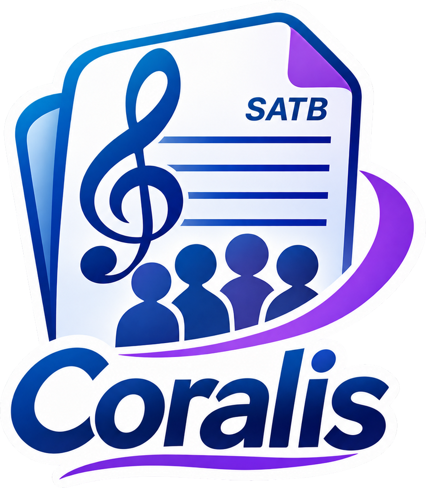

<p align="center"></p>

# Coralis

*Partituras corales a MusicXML* (paquete de Python: `omr-coral`).

Reconocimiento óptico de música (OMR) con autocorrección para partituras corales SATB.
Convierte un PDF o fotos en un MusicXML con las 4 voces (soprano, alto, barítono y bajo) y la letra.

> **Importante:** Coralis puede equivocarse. Lee la partitura con programas de reconocimiento
> automático y aplica reglas para corregir lo que puede, pero no es perfecto: notas, ritmos, letra,
> repeticiones o estrofas pueden salir mal, sobre todo en fotos, arreglos poco comunes o letra difícil
> de leer. El reporte marca los compases dudosos para que los revises. **Compara siempre el resultado
> con la partitura impresa: la decisión final la tienes tú.**

## Descargar

**Mac con chip de Apple (M1 o posterior):** descarga el `.dmg` de la última versión en
[Releases](https://github.com/OrlandoFloresC/Coralis/releases), ábrelo y arrastra Coralis a Aplicaciones.

- La primera vez, macOS dirá que no puede comprobar el desarrollador, porque la app no está firmada.
  Ábrela así: **Ajustes del Sistema → Privacidad y seguridad**, y abajo pulsa **«Abrir igualmente»**.
  Solo hace falta una vez.
- Al abrirse por primera vez, Coralis descarga sus lectores de partituras (Audiveris y homr, unos 400 MB).
  Puede tardar de 5 a 20 minutos; después ya no.
- Los resultados se guardan en **Documentos/Coralis**.

**Windows 10 u 11 (64 bits):** descarga `Coralis-…-Windows.exe` de la última versión en
[Releases](https://github.com/OrlandoFloresC/Coralis/releases) y ábrelo para instalar (no pide permisos
de administrador).

- Windows puede mostrar «Windows protegió su PC», porque la app no está firmada. Pulsa
  **Más información → Ejecutar de todos modos**. Solo hace falta una vez.
- Al abrirse por primera vez, Coralis descarga sus lectores de partituras (Audiveris y homr, unos 400 MB).
  Puede tardar de 5 a 20 minutos; después ya no.
- Los resultados se guardan en **Documentos\Coralis**. Al desinstalar, esa carpeta se conserva.

Coralis avisa al abrirse cuando hay una versión nueva.

## Instalación desde el código

Funciona en Windows, macOS y Linux.

Requisito: Python 3.11 o superior ([python.org](https://www.python.org/downloads/)).

```bash
python instalar.py
```

Esto crea un entorno virtual en `.venv`, instala las dependencias de Python y descarga
automáticamente las herramientas externas, sin pedir permisos de administrador:

| Herramienta | Uso | Instalación |
|---|---|---|
| Audiveris | motor OMR (notas y letra) | automática (descarga del instalador oficial a la carpeta de usuario) |
| homr | motor OMR (notas; no lee letra) | automática, en su propio entorno de Python |
| Idiomas OCR de Tesseract | lectura de la letra | automática |
| music21, Verovio | lectura y renderizado de MusicXML | automática (pip) |
| MuseScore 4 | renderizado alternativo | opcional, se detecta si está instalado |

Para verificar sin instalar nada: `omr check-tools`.

## Uso

```bash
# macOS / Linux
.venv/bin/omr recognize input/mi_partitura.pdf
# Windows
.venv\Scripts\omr recognize input\mi_partitura.pdf
```

La entrada puede ser un PDF, una imagen o una carpeta de imágenes (fotos, en orden alfabético).

El resultado es **un solo MusicXML con las 4 voces** (Soprano, Alto, Barítono, Bajo), con la música
escrita una vez por estrofa: la anacrusa como compás completo con silencios, un compás de
silencio entre estrofas y la letra de cada estrofa en todas las voces.

### Letra desde un archivo de texto (opcional)

Si junto a la partitura pones un `.txt` con el mismo nombre (por ejemplo `input/Sublime gracia.txt`),
la letra se toma de ahí en lugar del OCR. Una estrofa por párrafo, separadas por una línea en blanco;
los números de estrofa son opcionales:

```
1. Sublime gracia del Señor,
de muerte me libró.

2. Mi corazón enterneció,
mis dudas disipó.
```

El programa separa las sílabas solo (para forzar una separación, escribe guiones: `Su-bli-me`),
las reparte sobre las notas guiándose por lo que leyó el OCR, une las sinalefas («me‿el») y deja sin
sílaba las notas de melisma. También se puede indicar el archivo con `--letra ruta/al/archivo.txt`.

### Evaluación contra un MusicXML correcto

Si en `ground_truth/` hay un MusicXML hecho a mano con el mismo nombre que la entrada, al terminar se
compara automáticamente: porcentaje de notas correctas (altura y duración) y de sílabas, compás por
compás, antes (cada lectura de un solo motor) y después (resultado final). También a mano:

```bash
.venv/bin/omr evaluate "runs/<carpeta>"                       # usa ground_truth/<nombre>
.venv/bin/omr evaluate "runs/<carpeta>" --correcto otro.mxl
```

### Cómo funciona

1. Cada página se convierte en varias **versiones de imagen**: original, enderezada, limpia
   (sin lo que se transparenta de la página de atrás), binaria, con más contraste y reescalada.
2. **Cada motor lee cada versión** (2 motores × hasta 6 versiones), dos a la vez.
3. Las lecturas se **alinean compás por compás** y se **vota** por cada voz de cada compás:
   gana la versión que pasa las reglas musicales y, entre esas, la que más lecturas repiten.
   La letra se vota aparte, solo entre las lecturas que encontraron todas las líneas de ese sistema.
4. **Análisis por síntesis**: para cada compás, el programa calcula dónde deberían estar las cabezas
   de nota de la versión elegida y las compara con las que detecta en la imagen. Si otra versión
   leída explica más cabezas reales, la usa. Así se distinguen, por ejemplo, un do4 de un si♭3.
   (Las alteraciones no se ven así: si♭ y si♮ ocupan el mismo lugar en el pentagrama.)
5. El resultado se valida otra vez y se genera el reporte.

Tarda unos 2-3 minutos por página.

Cada ejecución crea su propia carpeta en `runs/<nombre>_<fecha>/`, y al terminar abre el reporte en el navegador:

```
pages/                        páginas a 300 dpi
variants/<versión>/           versiones de cada página que leyeron los motores
engines/<motor>/<versión>/    cada lectura: MusicXML crudo y log del motor
<título>.musicxml             RESULTADO FINAL: 4 voces, estrofas separadas
letra.txt                     copia del archivo de letra, si se usó
votacion.json                 qué versión ganó en cada compás y voz, y con cuántos votos
validation.json               hallazgos de las reglas sobre el resultado
report/index.html             reporte: cada compás con su original, lo que entendió el programa, cuántas
                              lecturas coinciden y la verificación de cabezas de nota sobre la imagen
summary.json                  resumen de las lecturas
evaluacion.html / .json       comparación con el MusicXML correcto (si hay uno en ground_truth/)
```

Opciones útiles:

```bash
omr recognize partitura.pdf --engines homr             # solo un motor
omr recognize partitura.pdf --variants original,limpia # menos versiones = más rápido
```

Para volver a votar y validar una ejecución sin releerla (por ejemplo, después de cambiar `config.yaml`):

```bash
.venv/bin/omr validate "runs/<carpeta>"
```

### Reglas de validación

| Regla | Qué revisa |
|---|---|
| Duración | Cada voz llena exactamente su compás (se aceptan anacrusa, compás final y compases partidos por repetición). |
| Rango | Cada nota cae dentro del rango de su voz (configurable). |
| Coherencia | Todos los pentagramas tienen el mismo compás, armadura y tempo; avisa los cambios. |
| Alteraciones | Alteraciones fuera de la tonalidad que nada justifica (ni otra voz, ni repetición, ni resolución por grado conjunto). |
| Letra | Todas las estrofas tienen el mismo número de sílabas por compás, y ninguna estrofa falta en un sistema entero. |
| Unísono / voz perdida | Dos voces de un pentagrama idénticas en todo el compás, o una voz callada mientras las demás cantan. |
| Melodía | Saltos improbables en una voz y ligaduras entre notas distintas. |
| Votación | Pocas lecturas coinciden con la versión elegida (salvo que la imagen la confirme). |
| Imagen | Las cabezas de nota no coinciden con la imagen y además las lecturas no se ponen de acuerdo. |

Las partituras a 2 pentagramas (soprano y contralto arriba, tenor y bajo abajo) se separan
automáticamente en 4 voces.

## Configuración

Copia `src/omr_coral/default_config.yaml` a `config.yaml` en la carpeta desde donde ejecutas
y cambia solo lo que necesites: rutas de herramientas, idiomas de la letra, rangos de cada voz, etc.

## Estado

- [x] Fase 1: instalación automática y reconocimiento con Audiveris
- [x] Fase 2: separación en 4 voces, validación por reglas y reporte HTML de compases dudosos
- [x] Fase 3: homr, variantes de preprocesamiento y votación
- [x] Fase 4: análisis por síntesis
- [x] Fase 5: salida en 4 voces con estrofas separadas, letra desde texto y evaluación
- [x] Ventana de escritorio (Coralis), copia digital en 2 pentagramas con repeticiones y signos,
      repeticiones desplegadas para practicar, revisión de signos y de notas con un clic

## Licencia

Coralis es software libre: puedes usarlo, estudiarlo, modificarlo y compartirlo bajo los términos
de la **GNU Affero General Public License, versión 3 o posterior** (AGPL-3.0-or-later).
El texto completo está en [LICENSE](LICENSE).

Si distribuyes una versión modificada (o la ofreces como servicio en red), debes publicar también
su código fuente bajo la misma licencia.

## Créditos

Coralis usa estos programas libres, que se descargan aparte desde sus páginas oficiales:

- [Audiveris](https://github.com/Audiveris/audiveris) — reconocimiento de partituras y letra (AGPL-3.0)
- [homr](https://github.com/liebharc/homr) — reconocimiento de notas (AGPL-3.0)
- [music21](https://github.com/cuthbertLab/music21), [Verovio](https://github.com/rism-digital/verovio),
  [pywebview](https://github.com/r0x0r/pywebview), OpenCV, Pillow y otras bibliotecas de Python.

**Respeta los derechos de autor de las partituras que conviertas.** Coralis no incluye partituras;
las pruebas usan solo ejemplos de dominio público.
